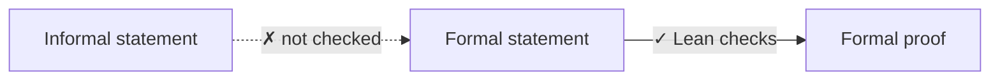
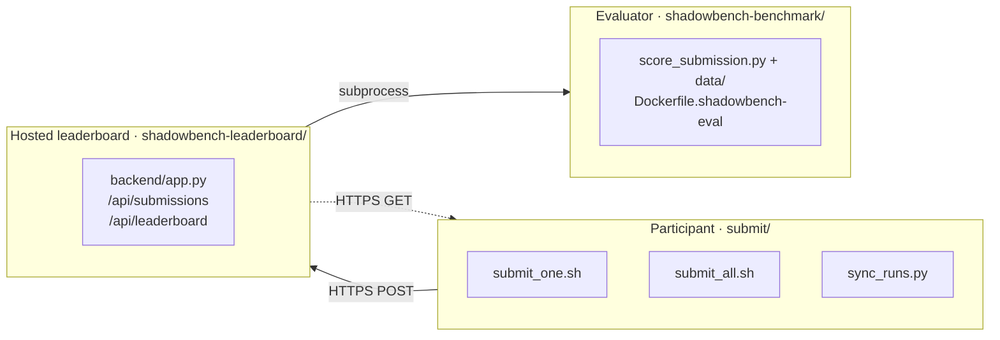

<div align="center">

# ShadowBench

### Toward Reliable Automatic Evaluation of Semantic Alignment in Autoformalization

<br/>

[](https://arxiv.org/abs/2608.29270)
[](https://github.com/ldilab/shadowbench)

[](https://huggingface.co/datasets/DicoTiar/ShadowBench/viewer/default/test)
[](https://www.codabench.org/competitions/16295/)
[](https://ldilab.github.io/shadowbench-leaderboard/)


<br/>

Hojae Han<sup>1\*</sup> · Jongyoon Kim<sup>2\*</sup> · Sanghyeok Park<sup>2\*</sup> · Dongwook Cheon<sup>2</sup> · Yeachan Park<sup>3</sup><br/>
Myeong Jae Jeon<sup>4</sup> · Sunjong Choe<sup>2</sup> · Soonho Kong<sup>5</sup> · Wonseok Hur<sup>2</sup> · Seung-won Hwang<sup>2†</sup> · Donghoon Hyeon<sup>2†</sup>

<sup>1</sup>ETRI · <sup>2</sup>Seoul National University · <sup>3</sup>Sejong University · <sup>4</sup>University of Maryland, College Park · <sup>5</sup>Amazon Web Services

<sub>\* Equal contribution · † Corresponding authors</sub>

<br/>

[Overview](#overview) •
[Layout](#layout) •
[Dataset](#dataset) •
[Agentic](#agentic) •
[Non-agentic](#non-agentic) •
[Reproduce](#reproduce) •
[Quick start](#quick-start) •
[Citation](#citation)

</div>

---

<a id="overview"></a>

## 🔍 Overview

Lean checks that a formal proof matches its formal statement. Nothing checks that the formal statement matches the informal one. ShadowBench measures this **semantic alignment** with an automatic metric, **SA-PASS**.



This repository contains two components:

| | Component | Directory | Description |
| :-: | --- | --- | --- |
| 🤖 | **ShadowBench Agent** | [`agentic/`](agentic/) | A Claude Code-based system for formal theorem proving. Four shell entrypoints under `agentic/commands/` reproduce the agentic and single-shot baseline experiments in the paper. |
| 📊 | **ShadowBench** | [`non_agentic/`](non_agentic/) | A curated suite of Lean 4 problems, a containerized evaluator, and a FastAPI leaderboard server. Participants submit jobs to a hosted instance through the `non_agentic/submit/` client. |

### How SA-PASS works

Each problem has hidden **shadow statements** $S_1, \dots, S_n$ that split the domain of the target theorem. A candidate formalization $\widehat{T}$ is scored with Lean-checked implications in two directions.

```math
F = \frac{\left|\{\, i : \widehat{T} \Rightarrow S_i \,\}\right|}{|S|}
\qquad
B = \mathbf{1}\Big\{ \bigwedge_{i=1}^{n} S_i \Rightarrow \widehat{T} \Big\}
```

```math
\text{SA-PASS} = \mathbf{1}\{F = 1 \wedge B = 1\}
\qquad
\text{SA-PASS}_{\text{soft}} = \frac{F + B}{2}
```

The generated theorem and proof must compile first. A compile failure gives 0 for both scores.

<details>
<summary><b>Example: AM-GM for positive reals, with shadows split at <i>x</i> = 1</b></summary>

<br/>

Shadow statements: $S_1 : \forall x \in \mathbb{R},\ 0 < x \le 1 \Rightarrow x + 1/x \ge 2$ and $S_2 : \forall x \in \mathbb{R},\ 1 \le x \Rightarrow x + 1/x \ge 2$.

| Candidate $\widehat{T}$ | Forward $F$ | Backward $B$ | SA-PASS | SA-PASS<sub>soft</sub> |
| --- | :-: | :-: | :-: | :-: |
| $\forall x,\ 0 < x \Rightarrow x + 1/x \ge 2$ (faithful) | 2/2 | ✅ | **1** | 1.00 |
| $\forall x,\ 1 \le x \Rightarrow x + 1/x \ge 2$ (restricted domain) | 1/2 | ✅ | **0** | 0.75 |
| $\forall x,\ 0 < x \Rightarrow x + 1/x \ge 2 \wedge R(x)$ (extra equality condition) | 2/2 | ❌ | **0** | 0.50 |

Here $R(x) : x + 1/x = 2 \Leftrightarrow x = 1$.

</details>

On compile-passed outputs from six agentic configurations, SA-PASS agrees with expert judgments on **98.8%** of cases, above compile checks, BLEU, LLM-as-judge, and BEq+.

---

<a id="layout"></a>

## 🗂️ Repository layout

```text
shadowbench/
├── agentic/                      # Mode A: ShadowBench Agent (Claude Code)
│   ├── commands/                 #   four shell entrypoints (single / folder × agentic / naive)
│   ├── scripts/                  #   Python orchestration, judges, BEQ scoring, statement tracker
│   ├── prompts/                  #   prompt templates (medium / hard / naive_*)
│   ├── configs/                  #   MCP server configs (experiment_mcp.json, empty_mcp.json)
│   ├── config/                   #   YAML examples (config_minif2f.yaml)
│   ├── conftest.py, pytest.ini   #   pytest plumbing
│   └── leanproblems → <your Lean project>   # symlink created during setup
│
├── non_agentic/                  # Mode B: hosted ShadowBench leaderboard
│   ├── shadowbench-leaderboard/  #   FastAPI backend + static frontend (the host)
│   │   ├── backend/              #     app.py, runner.py, db.py, settings.py, requirements.txt
│   │   └── frontend/             #     leaderboard.html, submit.test-run.html, admin UI, assets
│   ├── shadowbench-benchmark/    #   the evaluator (benchmark data kept private)
│   │   ├── score_submission.py   #     evaluator entrypoint
│   │   ├── run_benchmark.sh      #     local-run wrapper
│   │   ├── scripts/              #     docker_score.sh (optional runner wrapper)
│   │   ├── lean-toolchain        #     pinned Lean version
│   │   ├── sample_submission_spec.json, sample_result.json
│   │   └── lean-benchmark-guideline.md
│   └── submit/                   #   participant-side submission client
│       ├── submit_one.sh         #     POST a single submission to the leaderboard
│       ├── submit_all.sh         #     batch sweep over experiments/*.yaml
│       ├── sync_runs.py          #     pull completed runs back from the leaderboard
│       ├── models.yaml           #     model registry
│       └── experiments/          #     YAML sweep configs (shadow.yaml, proving*.yaml, ...)
│
├── data/                         # public split of the 178 ShadowBench problems
└── README.md
```

---

<a id="dataset"></a>

## 📚 Dataset

[`data/`](data/) contains the public split of all 178 ShadowBench problems, laid out as `data/<area>/<level>/<problem_id>/`.

| File | Contents |
| --- | --- |
| `text.md` | The informal source document: the theorem to formalize, with the surrounding definitions and the informal proof. |
| `meta.json` | The task specification: problem identifiers, area, level, `formalization_rules` (required preamble, target declaration name, and constraints), `target_decl` / `target_kind`, custom modules, toolchain pin, and source references. |

> [!NOTE]
> The gold Lean formalizations and the hidden shadow checkers used for scoring are **not** included. They live only on the evaluation server. Evaluation against them runs on the [hosted leaderboard](#non-agentic).

Directory levels and problem identifiers follow the paper's difficulty scale `L1` to `L3` (for example, `analysis/L1/ana_gen_L1_003`). The full public split is also on [🤗 Hugging Face](https://huggingface.co/datasets/DicoTiar/ShadowBench/viewer/default/test).

| Area | L1 | L2 | L3 | Total |
| --- | ---: | ---: | ---: | ---: |
| algebra | 19 | 4 | 3 | 26 |
| algebraic-geometry | 2 | 16 | 4 | 22 |
| analysis | 14 | 10 | 4 | 28 |
| combinatorics | 8 | 6 | 0 | 14 |
| geometry | 18 | 6 | 0 | 24 |
| number-theory | 17 | 0 | 2 | 19 |
| probability | 19 | 1 | 0 | 20 |
| topology | 17 | 9 | 0 | 26 |
| **Total** | **114** | **52** | **13** | **178** |

---

<a id="agentic"></a>

## 🤖 Mode A: Agentic

A Claude Code-based agent drives a Lean 4 toolchain (through `lean-lsp-mcp`) to produce and verify formal proofs over multiple rounds.

### Prerequisites

- **Lean 4** via `elan`. The toolchain version is pinned by `non_agentic/shadowbench-benchmark/lean-toolchain`.
- **Python 3.10+** with `venv`.
- **Claude Code CLI** (`claude`) on your `PATH`. See [anthropics/claude-code](https://github.com/anthropics/claude-code) for installation.
- **`lean-lsp-mcp`**. `run_experiment.sh` invokes the MCP server as `lean-lsp-mcp/numina-lean-mcp.sh`. Clone or install it as a sibling so this relative path resolves from the experiment sandbox. The companion implementation is *ShadowBench Lean LSP MCP*.

### Setup

```bash
cd agentic

# 1. Bridge a Lean 4 project of problem files into agentic/leanproblems/
#    (all four scripts reference leanproblems/). The public data/ split ships
#    informal statements only, so point this at your own Lean project of
#    problem .lean files.
ln -s <path-to-your-lean-project> leanproblems

# 2. Python environment (the scripts source agentic/.venv/bin/activate)
python3 -m venv .venv
source .venv/bin/activate
pip install -U pip
pip install pyyaml      # plus any further deps used by scripts/run_claude.py
```

### Entrypoints

Run all commands **from inside `agentic/`** so that `leanproblems/...` paths resolve.

| Script | What it does |
| --- | --- |
| `commands/run_experiment.sh <PROBLEM.lean> <MAX_ROUNDS> [flags]` | Agentic run on a single problem. Spawns an isolated sandbox with a per-experiment MCP server, multi-round agent loop, statement tracking, and per-round git commits. |
| `commands/run_folder_experiment.sh <FOLDER> <MAX_ROUNDS> [flags]` | Calls `run_experiment.sh` on every `.lean` file in `<FOLDER>` in sequence. Tracks success, failed, and skipped counts. |
| `commands/run_naive_claude.sh <PROBLEM.lean> [flags]` | Single-shot baseline. Calls Claude with no tools and no MCP servers, then compiles the response with `lake env lean`. Two modes: `--mode autoformalize` (extract NL from comments) or `--mode complete` (full Lean file). |
| `commands/run_naive_claude_folder.sh <FOLDER> [flags]` | Batch baseline runner. Performs a Mathlib cache pre-flight (SIGBUS detection, cache repair) before sweeping a folder. |

<details>
<summary><b>Common flags</b></summary>

<br/>

| Flag | Default | Applies to |
| --- | --- | --- |
| `--model {opus\|sonnet\|haiku}` | `opus` | all |
| `--effort {low\|medium\|high\|xhigh\|max}` | unset | all |
| `--name <EXPERIMENT_NAME>` | `<model>_<datetime>` (agentic), `naive_claude_code` (baseline) | all |
| `--failure-memory` | off | agentic only |
| `--no-guard` | on (guard disabled by default in scripts) | agentic only |
| `--mode {autoformalize\|complete}` | `autoformalize` | naive only |
| `--timeout <SECONDS>` | `300` | naive only |
| `--skip-existing` | on | folder runners |
| `--recursive` | off | naive folder |
| `--keep-sandbox` | off | naive only |

</details>

### Examples

```bash
# Agentic, single problem, 3 rounds, default model (opus)
./commands/run_experiment.sh leanproblems/<dataset>/<problem>.lean 3

# Agentic, full subfolder with failure-memory RL and a custom name
./commands/run_folder_experiment.sh leanproblems/<dataset>/<subfolder> 3 \
    --name ablation_full --failure-memory

# Naive baseline, single problem, "complete" mode
./commands/run_naive_claude.sh leanproblems/<dataset>/<problem>.lean \
    --mode complete --model sonnet

# Naive baseline, recursive folder
./commands/run_naive_claude_folder.sh leanproblems/<dataset> \
    --recursive --name L1_naive
```

### Outputs

Results land in `agentic/results/<EXPERIMENT_NAME>/<BENCHMARK_PATH>/<PROBLEM_NAME>/`:

- `run<N>.log`: streaming logs
- per-round JSON
- `mcp_logs/`: MCP traffic
- `final_answer.lean`
- `config.yaml` (generated)

> [!WARNING]
> **Known issue.** `agentic/scripts/statement_tracker.py:9` imports `extract_sublemmas`, but `agentic/scripts/extract_sublemmas.py` is not part of this snapshot. The import fails when `python3 -m scripts.run_claude` is invoked. If you hit `ModuleNotFoundError: extract_sublemmas`, stub the module (`pass` only) or remove the import in `statement_tracker.py` for runs that do not exercise sub-lemma extraction.

---

<a id="non-agentic"></a>

## 📊 Mode B: Non-agentic ShadowBench

Three components coordinate through environment variables, with no hard-coded paths.



> [!TIP]
> To submit to the official hosted instance, see the [ICML 2026 AI4Math challenge page](https://www.codabench.org/competitions/16295/). Current rankings are on the [live leaderboard](https://ldilab.github.io/shadowbench-leaderboard/).

### B.1 Run the leaderboard server

```bash
cd non_agentic/shadowbench-leaderboard
python3 -m venv .venv && source .venv/bin/activate
pip install -r backend/requirements.txt

export SHADOWBENCH_BENCHMARK_DIR="$(pwd)/../shadowbench-benchmark"
export SHADOWBENCH_BENCHMARK_RUNNER="python score_submission.py --spec {spec} --out {out}"
export ADMIN_PASSWORD="<long-random-secret>"   # optional, protects /api/admin/*
# optional tuning:
#   LEADERBOARD_DB=./data/leaderboard.sqlite
#   SHADOWBENCH_BENCHMARK_TIMEOUT_SEC=3600
#   LEADERBOARD_MAX_WORKERS=1
#   LEADERBOARD_ALLOW_ORIGINS="https://your.host"

uvicorn backend.app:app --host 0.0.0.0 --port 8000
```

| Method | Route | Purpose |
| :-: | --- | --- |
| `POST` | `/api/submissions` | Accept a `SubmissionIn` JSON and queue an evaluator subprocess. |
| `GET` | `/api/leaderboard.json` | Ranked runs for the static frontend. |
| `GET` | `/api/downloads/...` | Completed-run artifacts (used by `submit/sync_runs.py`). |
| `*` | `/api/admin/...` | Admin-only endpoints, gated by `ADMIN_PASSWORD`. |

The static frontend lives under `frontend/` (`leaderboard.html`, `leaderboard.admin.html`, `submit.test-run.html`). Serve it behind any reverse proxy that forwards `/api/*` to uvicorn. A sample systemd unit is in `shadowbench-leaderboard/README_systemd.md`.

### B.2 Run the evaluator locally (sanity check)

```bash
cd non_agentic/shadowbench-benchmark
python score_submission.py \
    --spec sample_submission_spec.json \
    --out  /tmp/abm_result.json
```

Or use the optional Docker wrapper:

```bash
bash scripts/docker_score.sh sample_submission_spec.json /tmp/abm_result.json
```

`Dockerfile.shadowbench-eval` builds the container image referenced by the `runtime.docker_image` field of a submission spec.

### B.3 Submit a job (participant client)

| Script | Role |
| --- | --- |
| `submit_one.sh` | POSTs a single submission. |
| `submit_all.sh` | Reads a YAML sweep config (Cartesian product over models × tokens × temperatures × areas × levels) and calls `submit_one.sh` once per combination. |
| `sync_runs.py` | Pulls completed runs from the leaderboard back to a local results tree. |

```bash
cd non_agentic/submit

export SHADOWBENCH_SUBMIT_URL="https://<your-leaderboard-host>/api/submissions"
export SHADOWBENCH_API_KEY="<your-token>"
# (optional) override download endpoint used by sync_runs.py:
# export SHADOWBENCH_DOWNLOAD_BASE_URL="https://<your-leaderboard-host>/api/downloads"

# Single submission:
./submit_one.sh "$(cat <<'EOF'
{
  "name": "my-run-001",
  "org":  "my-team",
  "model": "claude-sonnet-4-6",
  "max_tokens": 8192,
  "temperature": 0.6,
  "areas":  ["algebra", "topology"],
  "levels": ["L1", "L2"],
  "prompt_components": {"informal_statement": true}
}
EOF
)"

# Sweep from a YAML config (see experiments/shadow.yaml for the full schema):
./submit_all.sh experiments/shadow.yaml

# Pull completed runs:
python sync_runs.py
```

The request body wraps the user config inside a `submissionSpec` envelope (`model_cmd`, `env`, `eval`, `runtime`, `bench`). See `submit_one.sh` for the exact schema and for how environment variables (`VLLM_BASE_URL`, `VLLM_MODEL`, `SHADOWBENCH_EVAL_PROJECT_DIR`, ...) are passed through.

---

<a id="reproduce"></a>

## 🧪 Reproducing paper results

| Sweep | Config | Notes |
| --- | --- | --- |
| Main non-agentic table | `non_agentic/submit/experiments/shadow.yaml` | Full ShadowBench sweep, hidden checker enabled |
| "Proving" ablation | `non_agentic/submit/experiments/proving.yaml` | Without auxiliary-lemma exposure |
| "Proving (with NL)" | `non_agentic/submit/experiments/proving_w_nl.yaml` | Adds informal statement |
| "Proving (no aux)" | `non_agentic/submit/experiments/proving_wo_aux.yaml` | Drops auxiliary lemmas |
| Agentic numbers | `agentic/commands/run_folder_experiment.sh leanproblems/<dataset> <ROUNDS> --model <opus\|sonnet\|haiku>` | One folder per row |
| Single-shot Claude baseline | `agentic/commands/run_naive_claude_folder.sh leanproblems/<dataset> --mode {autoformalize\|complete}` | |

Result post-processing scripts (judges, BEQ scoring, MCP stats) live under `agentic/scripts/`.

---

<a id="quick-start"></a>

## ⚡ Quick start

```bash
git clone https://github.com/ldilab/shadowbench.git && cd shadowbench

# Mode A: agentic
cd agentic
ln -s <path-to-your-lean-project> leanproblems
python3 -m venv .venv && source .venv/bin/activate && pip install pyyaml
./commands/run_naive_claude.sh leanproblems/<dataset>/<problem>.lean --mode complete

# Mode B: leaderboard (in another shell)
cd ../non_agentic/shadowbench-leaderboard
python3 -m venv .venv && source .venv/bin/activate
pip install -r backend/requirements.txt
SHADOWBENCH_BENCHMARK_DIR="$(pwd)/../shadowbench-benchmark" \
    uvicorn backend.app:app --port 8000

# Mode B: submit a job (yet another shell)
cd ../submit
SHADOWBENCH_SUBMIT_URL="http://localhost:8000/api/submissions" \
SHADOWBENCH_API_KEY="dev" \
    ./submit_all.sh experiments/shadow.yaml
```

---

<a id="citation"></a>

## 📝 Citation

If you use ShadowBench, please cite:

```bibtex
@article{han2026shadowbench,
  title   = {ShadowBench: Toward Reliable Automatic Evaluation of Semantic Alignment in Autoformalization},
  author  = {Han, Hojae and Kim, Jongyoon and Park, Sanghyeok and Cheon, Dongwook and Park, Yeachan and Jeon, Myeong Jae and Choe, Sunjong and Kong, Soonho and Hur, Wonseok and Hwang, Seung-won and Hyeon, Donghoon},
  journal = {arXiv preprint arXiv:2608.29270},
  year    = {2026}
}
```

<div align="center">
<br/>
<sub>ETRI · Seoul National University · Sejong University · University of Maryland, College Park · Amazon Web Services</sub>
</div>
